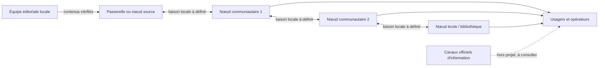
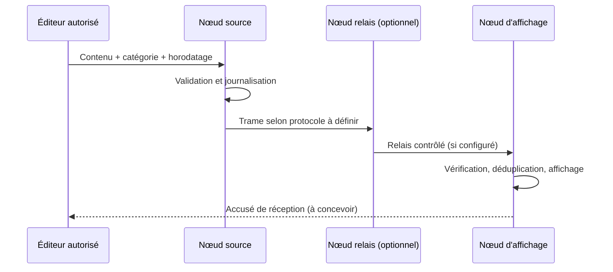

# Architecture conceptuelle

## Nœuds et flux

Le dessin est fonctionnel et non une promesse de topologie mesh. Technologie radio, portée, fréquences autorisées, routage, alimentation et contraintes locales restent à spécifier et tester.

## Cycle de message proposé

## Priorités

Les classes quotidiennes et prioritaires sont des catégories d’application. Une priorité logicielle ne garantit ni réception radio ni délai d’affichage. Avant tout usage réel, définir une politique d’autorisation, d’authentification, d’expiration, de révocation et de repli vers les canaux officiels.

## Couches à développer

| Couche | État dans ce dépôt | Travail nécessaire |
|---|---|---|
| Vocabulaire / identifiants | À définir avec les utilisateurs | Gouvernance et versionnement du dictionnaire |
| Trame Rust | Démonstrateur 3 octets | Format stable, compatibilité, erreurs et tests |
| Compression | Non implémentée | Corpus de référence, comparaison avec UTF-8 et métadonnées incluses |
| Transport radio | Non implémenté | Choix matériel, réglementation, tests de portée et d’interférence |
| Sécurité | Non implémentée | Modèle de menace, clés, signatures, anti-rejeu, mises à jour sûres |
| Affichage / ESP32-S3 | Non implémenté | Référence exacte de carte, écran, broches, mémoire et pilotes |
| Exploitation terrain | Non validée | Maintenance, énergie, formation, procédures et support |
